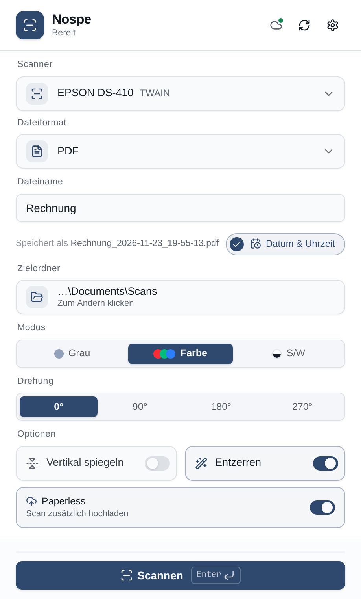
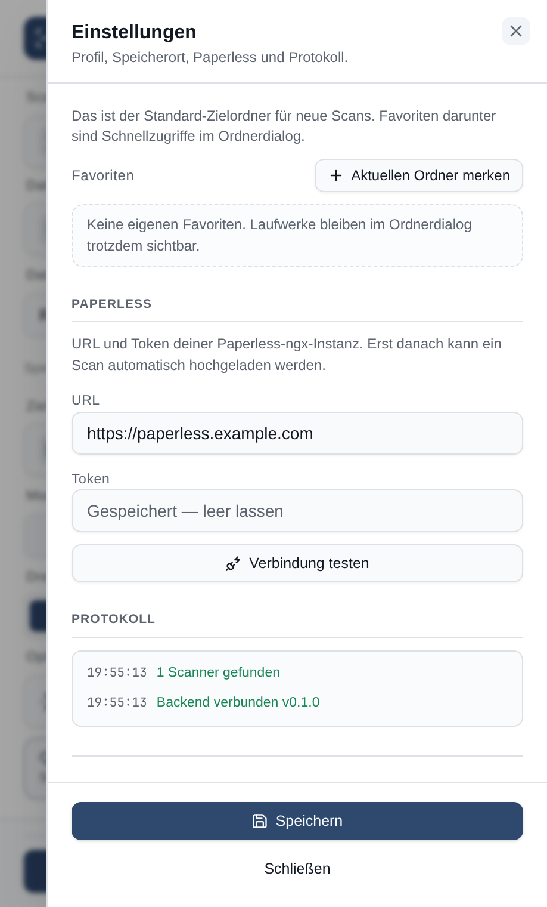

<div align="center">

# Nospe

**Dokumente scannen, als PDF speichern und direkt zu Paperless-ngx schicken.**

Eine kleine Windows-App für den Epson DS-410 und weitere Scanner.

[Selbst bauen und betreiben](#selbst-bauen-und-betreiben) · [Entwicklung](#entwicklung)

</div>

<table>
<tr>
<td width="50%"></td>
<td width="50%"></td>
</tr>
</table>

<sub>Aktuelle Oberfläche mit Demo-Scanner und Beispielwerten. Die Bilder zeigen keinen echten Scan oder Upload.</sub>

## Warum Nospe?

Ich habe Nospe für meinen Epson DS-410 gebaut. Ich wollte eigentlich nur Dokumente scannen und direkt in Paperless-ngx ablegen. Das fast ein Jahrzehnt alte UI der Epson-App hat mich dabei ziemlich genervt.

Also habe ich mir eine eigene kleine App geschrieben. Nospe ist ein Hobbyprojekt, das ich hauptsächlich für mich gebaut und dann einfach veröffentlicht habe.

- PDFs im eigenen Zielordner speichern, mit eigenem Dateinamen oder automatisch mit Datum und Uhrzeit.
- Scans optional direkt an die eigene Paperless-ngx-Instanz schicken. Die lokale PDF bleibt erhalten.
- Farbe, Graustufen oder Schwarzweiß auswählen. Scan-Profile für einseitigen Einzug und Duplex sind dabei.

Aktuell ist Nospe im Entwicklungsstand. Es gibt noch keinen fertigen Release-Download. Die Windows- und Hardware-Prüfungen stehen unten unter [Stand und Grenzen](#stand-und-grenzen).

## Selbst bauen und betreiben

Nospe läuft auf deinem Windows-Rechner. Die Desktop-App startet ihr FastAPI-Backend lokal und beendet es beim Schließen wieder. Der Zugriff bleibt auf `127.0.0.1` beschränkt.

### Voraussetzungen

- Windows 10 oder 11, 64 Bit.
- Ein Scanner mit TWAIN- oder WIA-Treiber oder ein eSCL/AirScan-Netzwerkscanner. Für den Epson DS-410 sind Epson Scan 2 und der 64-Bit-TWAIN-DSM vorgesehen.
- Zum Bauen Git, Python 3.11+ über `uv`, Node.js 20+, Rust mit MSVC und die Visual Studio Build Tools mit C++-Workload.

Die Einrichtung der Werkzeuge und Treiber steht in der [Installationsanleitung](docs/INSTALL.md). Die [TWAIN-Anleitung](docs/TWAIN_SETUP.md) erklärt DSM und Treiber-Bitness.

### Windows-Installer bauen

In PowerShell, nach der Einrichtung der Voraussetzungen:

```powershell
git clone https://github.com/janoschbl/nospe.git
cd nospe\backend
uv sync
uv run python -m pytest -q
uv run python scripts/verify_twain.py
uv run pyinstaller --clean --noconfirm --distpath ..\frontend\src-tauri\binaries --workpath build\pyinstaller nospe_backend.spec

cd ..\frontend\src-tauri
Copy-Item binaries\nospe-backend.exe binaries\nospe-backend-x86_64-pc-windows-msvc.exe -Force
cargo check

cd ..
npm ci
npm run tauri build
```

Der Installer liegt danach unter `frontend\src-tauri\target\release\bundle\nsis\`. Vor der Installation eine laufende Nospe-App schließen. Beim normalen App-Start werden Port und Secret automatisch erzeugt.

### Die eigene Paperless-Instanz anbinden

1. In Nospe die **Einstellungen** öffnen und den **Zielordner** für die PDFs setzen.
2. Unter **Paperless** die URL und einen API-Token der eigenen Paperless-ngx-Instanz eintragen und **Speichern** wählen.
3. Mit **Verbindung testen** prüfen, ob die gespeicherten Zugangsdaten funktionieren.
4. Auf der Hauptseite **Paperless** aktivieren und scannen.

Die Paperless-Instanz betreibst du unabhängig von Nospe. Sie kann im eigenen Netz oder über HTTPS erreichbar sein. `http://` ist auf lokale Adressen beschränkt. Nospe bringt keinen Paperless-Server mit.

Einstellungen liegen unter `%APPDATA%\Nospe\config.json`. Der Paperless-Token wird unter Windows per DPAPI verschlüsselt und an die konfigurierte Server-URL gebunden. Nach einem Wechsel des Servers muss er neu eingegeben werden.

## Entwicklung

Die Oberfläche besteht aus React, TypeScript und Tauri 2. Das Python-Backend nutzt FastAPI und erzeugt die PDFs. Scanner werden über TWAIN, WIA 2.0 oder eSCL/AirScan gefunden. Tauri übergibt der Oberfläche die lokale Backend-Adresse und das Secret.

### Backend starten

Im geklonten Repo, Terminal 1:

```powershell
cd backend
uv sync
$env:NOSPE_DEV = "1"
$env:NOSPE_API_PORT = "8765"
$env:NOSPE_API_SECRET = "dev-secret-0123456789abcdef"
uv run python run_backend.py
```

Das feste Secret ist ein Beispiel für lokale Entwicklung. Bei der installierten App übernimmt Tauri den Handshake mit einem zufälligen Secret pro Start.

### Desktop-App starten

Im Repo-Ordner, in einem zweiten Terminal:

```powershell
cd frontend
npm ci
$env:NOSPE_API_PORT = "8765"
$env:NOSPE_API_SECRET = "dev-secret-0123456789abcdef"
npm run tauri dev
```

### Oberfläche im Browser starten

Alternativ zum Tauri-Host, im Ordner `frontend`:

```powershell
npm ci
$env:VITE_NOSPE_API_URL = "http://127.0.0.1:8765"
$env:VITE_NOSPE_API_SECRET = "dev-secret-0123456789abcdef"
npm run dev
```

Die Oberfläche läuft unter `http://localhost:5173`. Backend-Tests und Web-UI lassen sich auch unter Linux und macOS ausführen. Der dokumentierte Betrieb mit Scanner ist auf Windows ausgelegt.

### Tests und Build

Die Befehle beginnen jeweils im Repo-Ordner:

```powershell
cd backend
uv run python -m pytest -q

cd ..\frontend
npm run build

cd src-tauri
cargo check
```

### Projektstruktur

| Pfad | Inhalt |
| --- | --- |
| `frontend/src/` | Oberfläche, API-Client und TypeScript-Typen |
| `frontend/src-tauri/` | Rust-Host, Sidecar-Start und Installer-Konfiguration |
| `backend/app/` | FastAPI, Scanner-Zugänge, PDF, Einstellungen und Paperless-Upload |
| `backend/app/security.py` | Secret-, Host- und Origin-Prüfung der lokalen API |
| `twain_ds/` | Virtueller TWAIN-Scanner für die Entwicklung |
| `docs/` | Installation, TWAIN-Setup und Screenshots |

## Stand und Grenzen

- Backend, Scanner-Registry und Sicherheitsmodell sind implementiert und mit automatisierten Tests unter Linux und simulierten Geräten geprüft.
- TWAIN für den Epson DS-410 ist implementiert. Der Ablauf muss am echten Gerät geprüft werden.
- WIA und eSCL sind bislang nur gegen simulierte Geräte getestet.
- Rust-Host und DPAPI-Tokenverschlüsselung sind laut bisherigem Projektstand noch nicht unter Windows ausgeführt beziehungsweise kompiliert worden.
- Einige sichtbare Optionen sind bislang nur UI-Einstellungen, darunter Drehung, Spiegeln, Entzerren und zusätzliche Dateiformate. Der Backend-Scan erzeugt PDFs; Profil und Farbmodus werden übergeben.
- Der virtuelle Scanner ist ein Entwicklungswerkzeug.

Die [Checkliste für den ersten Windows-Test](docs/INSTALL.md#7-erster-test-checkliste) beschreibt die noch offenen Prüfungen.

## Weitere Dokumentation

- [Installation und Fehlersuche](docs/INSTALL.md)
- [TWAIN-DSM und Epson-Treiber](docs/TWAIN_SETUP.md)
- [Architektur, lokale API, Sicherheitsmodell und Release-Ablauf](DEVELOPMENT.md)
- [Virtueller TWAIN-Scanner](twain_ds/README.md)
